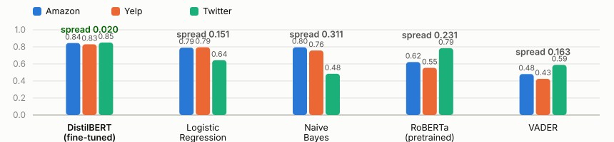
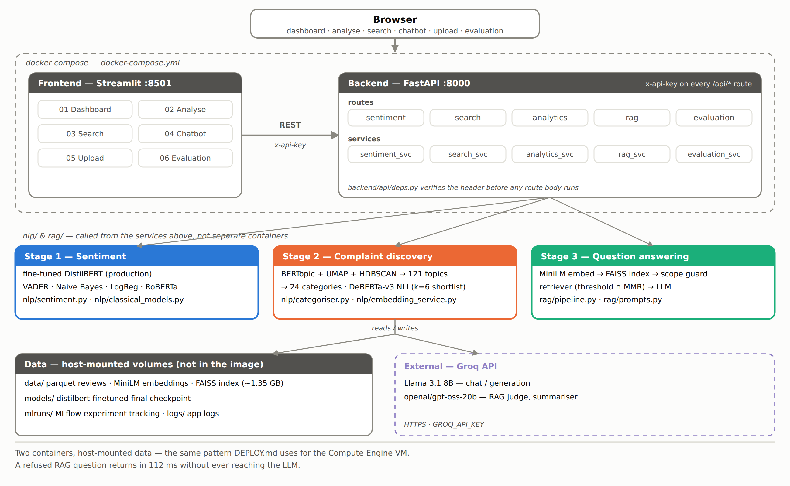

# FeedbackAnalytics


**Fine-tuning a small transformer on multi-domain customer feedback — and measuring what fine-tuning actually buys you.**

The usual claim is that fine-tuning buys accuracy. Across three very different kinds of feedback, it mostly buys something else: **consistency**.

MSc Data Science dissertation, University of Surrey. 642,692 reviews from Amazon products, Yelp businesses and Twitter Airline complaints.

---

## The headline result

Same held-out set for every model, then broken down by platform. The aggregate column is what most papers report. The spread column is where the story is.

| Model | Overall macro F1 | Amazon | Yelp | Twitter | **Spread** |
|---|---|---|---|---|---|
| **DistilBERT (fine-tuned)** | **0.8244** | 0.8448 | 0.8301 | 0.8505 | **0.020** |
| Logistic Regression | 0.8033 | 0.7908 | 0.7948 | 0.6434 | 0.151 |
| Naive Bayes | 0.7580 | 0.7952 | 0.7573 | 0.4838 | 0.311 |
| RoBERTa (pretrained) | 0.5694 | 0.6218 | 0.5544 | 0.7853 | 0.231 |
| VADER | 0.4381 | 0.4811 | 0.4252 | 0.5880 | 0.163 |



Fine-tuned DistilBERT beats logistic regression by **two points** on aggregate — thin enough that "just use logistic regression" is a fair challenge.

Then look at the spread. Every other model swings 15 to 31 points depending on which platform it's handed. DistilBERT swings **two**. Logistic regression loses 15 points on tweets. Pretrained RoBERTa is the *best model in the study* on tweets at 0.7853 — it was pretrained on Twitter — and the worst overall, losing 23 points on Yelp prose.

**Fine-tuning bought a model you can point at any of three registers without knowing in advance which one it is.** If your traffic is single-domain and you know the domain, the classical baseline is genuinely competitive and far cheaper. If it isn't, the two-point aggregate gap badly understates the difference.

Significant against logistic regression at p = 1.7 × 10⁻²¹ (McNemar's exact test). Nine of ten pairwise comparisons hold at p < 0.05; Naive Bayes and pretrained RoBERTa cannot be separated (p = 0.82), reported rather than glossed.

📊 **[Full results →](RESULTS.md)** — fine-tuning configuration and per-epoch curves, the binary re-evaluation that isolates the failure to one class, taxonomy evaluation, RAG vs standalone LLM, and the metadata-tagging ablation.

---

## Architecture


```
Reviews (Amazon · Yelp · Twitter)
  │
  ├─ Stage 1  Sentiment          fine-tuned DistilBERT (production path)
  │                              VADER · NB · LogReg · RoBERTa (baselines)
  │
  ├─ Stage 2  Complaint discovery BERTopic + UMAP + HDBSCAN → 121 topics
  │                               → 24-category taxonomy
  │                               DeBERTa-v3 zero-shot (shortlist k=6 → NLI)
  │
  └─ Stage 3  Question answering  MiniLM → FAISS → scope guard
                                  → grounded retriever (threshold ∩ MMR)
                                  → Llama 3.1 8B (Groq)
```

Three stages because monitoring, diagnosis and investigation are different jobs with different failure modes — and different evaluation regimes. A macro F1, a coherence score and a faithfulness score are not commensurable, so the comparison is run stage by stage rather than collapsed into one table.

Served as two containers: FastAPI backend, Streamlit frontend. Two guards sit in front of generation — a keyword filter and an LLM classifier reject out-of-scope questions before retrieval is attempted; a similarity threshold rejects questions where retrieval found nothing relevant enough to answer from. A refused question returns in 112 ms because neither guard reaches the generator.

**Stack.** Python 3.12 · PyTorch · Hugging Face Transformers · sentence-transformers · FAISS · LangChain · Groq · BERTopic · UMAP · HDBSCAN · scikit-learn · spaCy · RAGAS · MLflow · FastAPI · Streamlit · Docker

<details>
<summary><strong>Full system architecture</strong> — containers, routes, services, data & external calls</summary>



</details>

---

## Running it

```bash
cp .env.example .env          # add GROQ_API_KEY
docker compose up --build
```

Frontend on `:8501`, backend on `:8000` (OpenAPI docs at `/docs`). Without Docker:

```bash
uvicorn backend.main:app --reload --port 8000
streamlit run frontend/app.py
```

`data/` and `models/` are gitignored — roughly 3 GB of index and model artefacts are produced by the pipeline scripts and mounted as volumes rather than committed. **[DEPLOY.md](DEPLOY.md)** lists exactly what's needed and covers GCP deployment.

Every `/api/*` route except `/api/health` requires an `x-api-key` header. Set `ENVIRONMENT=production` and the backend refuses to start unless a real key is configured.

**Reproducibility.** Seeds fixed at 42 throughout, dependencies pinned, classical training and evaluation tracked in MLflow (`mlflow ui` → `localhost:5000`). Every table in [RESULTS.md](RESULTS.md) cites the file that produced it. Nothing reported was typed by hand.

---

## Screenshots

<!--
  Add your own screenshots here, e.g. after running `docker compose up --build`
  and exercising the dashboard / chatbot. Save images to docs/figures/ and
  reference them the same way the figures above are referenced:

  
  
-->

---

## Limitations

The short version. [Full discussion →](RESULTS.md#limitations)

- **The fine-tuned model's shared-test-set figure is the least controlled number here.** DistilBERT was developed against a separately generated corpus version, so part of the shared test set overlaps data it saw. Its clean figure — **0.8375** on its own held-out partition — is the one to trust. The other four models are unaffected.
- **Labels are derived from star ratings**, so a four-star review containing a complaint is labelled positive. This bounds every model's ceiling.
- **Generation evaluation is n = 5**, with the same model family generating and grading. Those findings are directional, not precise.
- **`SIMILARITY_THRESHOLD = 0.35` is unvalidated** — a starting point, not a calibrated constant.
- **Three of four planned ablations were not run.** Since component metrics identify retrieval as the weak point, those are the most consequential missing experiments.

---

## Repository

```
backend/     FastAPI app — routes, services, schemas, auth
frontend/    Streamlit UI — dashboard, analyse, search, chatbot, upload
nlp/         Sentiment models, categoriser, embedding service
rag/         Retrieval pipeline, prompts, guards
scripts/     Preprocessing, training, index building, discovery
evaluate/    Evaluation and ablation harnesses
notebooks/   EDA, classical models, DistilBERT fine-tuning
docs/        Dissertation chapters and figures
```

## Licence

MIT — see [LICENSE](LICENSE).
