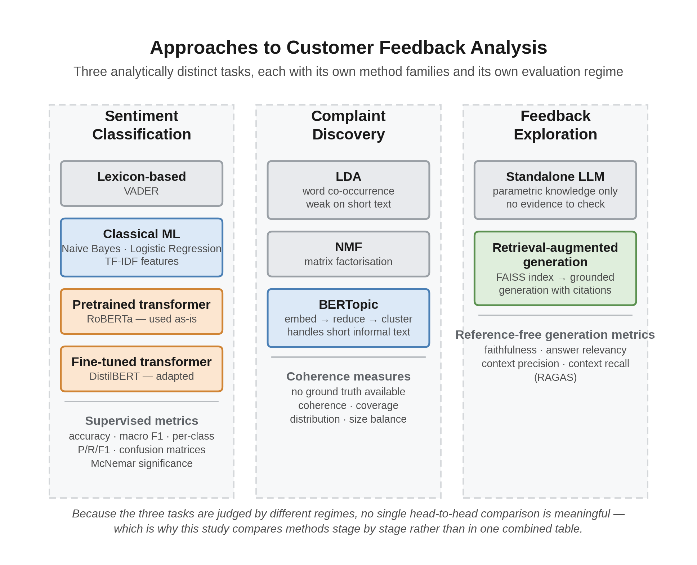

# Chapter 2 — Literature Review

This chapter reviews the research the present study builds on and argues with. Its purpose is not to catalogue what has been published, but to work out what is already settled, what is still contested, and where the evidence needed to choose between methods is missing. That last point is what the dissertation responds to, so the review is written to lead into it.

The chapter is organised in four parts. Section 2.1 reviews the substantive literature: why customer feedback analysis matters, how the problem has been tackled, how the competing studies compare, and what gap remains. Section 2.2 examines the supporting literature behind the methodological decisions taken here, covering datasets and evaluation design. Section 2.3 reviews the tools and technologies themselves and justifies the specific choices made. Section 2.4 summarises and connects the review to the methodology in Chapter 3.

Emphasis falls on work published since 2019, since transformer-based methods and retrieval-augmented generation have both changed substantially within that window. Older work is cited only where it introduced something still in active use.

Every source cited here was verified against the publisher record, the ACL Anthology, arXiv or a DOI resolver. Two claims met during the review could not be traced to a verifiable publication — a reported LDA-against-BERTopic coherence comparison, and a three-class sentiment benchmark figure — and both were removed rather than attributed to a source that may not support them. The consequence for Chapter 5 is recorded in Section 5.4, where the comparison built on the second of those figures is replaced by this study's own binary re-evaluation.

---

## 2.1 Literature Review

### 2.1.1 Research context

Customer feedback is unusual among data sources in being simultaneously abundant, unsolicited and directly actionable. A dissatisfied customer writing a review is describing a specific failure without being prompted, which is information that surveys struggle to obtain. The difficulty is volume. Platforms such as Amazon and Yelp hold review counts in the tens of millions, and no analyst team reads more than a sample.

Academic interest has followed commercial interest closely. Sentiment analysis grew into one of the largest subfields of applied natural language processing, and the surveys of the period document a steady migration from lexicon and feature-based methods towards learned representations (Pang & Lee, 2008). More recently the arrival of large language models has pushed the field towards generation: instead of classifying feedback, systems are now expected to summarise it, answer questions about it, and recommend action.

The relevance to industry is immediate, and the reason is specific. Sentiment classification supports monitoring; it tells an organisation how bad things are. Topic and complaint discovery supports diagnosis; it tells them what is wrong. Question answering over the corpus supports investigation; it lets an analyst pursue a particular concern. These are different jobs with different failure modes, and treating them as one problem is part of why method selection in this area is often poorly evidenced.

Figure 2.1 shows how the literature reviewed in this chapter maps onto those three jobs, and where each method family sits.

{width=4.6in}

**Figure 2.1** — Taxonomy of approaches to customer feedback analysis. The three tasks are analytically distinct, draw on different method families, and are judged by different evaluation regimes — which is why this study compares methods stage by stage rather than in a single combined table. *(Source: `docs/figures/fig_2_1_taxonomy.png`.)*

The point the figure makes is worth stating in words too, because it shapes everything that follows. Reading down any one column gives a sequence of methods that can sensibly be ranked against each other. Reading across the columns does not: a macro F1 score and a coherence score are not commensurable, and neither is comparable to a faithfulness score. Studies that report a single headline number for a feedback-analysis system are implicitly collapsing these three regimes into one, and that collapse is where a good deal of the reported evidence loses its meaning.

### 2.1.2 Current state of the art

**Sentiment classification.** The dominant approach is now the fine-tuned transformer. BERT established the pattern of pretraining a bidirectional encoder and adapting it to a downstream task (Devlin et al., 2019), and the variants that followed traded accuracy against cost in different ways. RoBERTa improved pretraining without changing the architecture (Liu et al., 2019), while DistilBERT reduced parameters by roughly 40% through distillation while retaining most of the performance (Sanh et al., 2019). The practical consequence is that a strong classifier is now a fine-tuning job rather than a research project.

Recent empirical work on review data supports the general ranking. Ali et al. (2024) compared machine learning, deep learning and transformer-based techniques on Amazon product reviews and found BERT outperforming every classical and deep-learning model tested. Shaukat (2024) reached a compatible but more qualified conclusion, benchmarking Random Forest, Naive Bayes and SVM against GPT-4 on product reviews: the classical models held their own on short, concise comments — SVM best among them — while the language model pulled ahead on longer, context-rich text. That length-conditional result is worth noting here, because the corpus used in this study spans exactly that range, from 19-word tweets to 85-word Yelp narratives. Sunar (2025) extends the comparison to embedding choice, evaluating traditional, pre-transformer and transformer paradigms on the Amazon Magazine Subscriptions 2023 dataset across static (GloVe, FastText) and contextual (BERT, DistilBERT) representations, and reports DistilBERT achieving both the highest accuracy at 92% and the lowest cross-entropy loss.

Two things about this body of work matter for the present study. First, the comparisons are consistently run within a single domain, most often Amazon product reviews. Second, they report aggregate accuracy or weighted F1 far more often than per-class behaviour. Both choices make transformer superiority easier to demonstrate and harder to qualify — and, as Chapter 4 shows, both conceal exactly the failure this study encountered.

**Domain adaptation and transfer.** The assumption that a pretrained transformer transfers well is itself an empirical claim, and the models are not domain-neutral. The `twitter-roberta` family, for instance, was pretrained on tweets and benchmarked on Twitter-specific tasks (Barbieri et al., 2020), which is the reason it performs strongly on short social text. Whether that advantage survives a move to long-form review prose is exactly the kind of question single-domain studies cannot answer.

A separate literature does address this directly, though from a different angle. Cross-domain sentiment classification treats the mismatch as a transfer-learning problem, seeking representations that hold across source and target domains. Recent work in this line includes feature projection with multi-source attention, designed to reduce negative transfer when knowledge is drawn from several source domains at once (Kong et al., 2023). The underlying mechanism in much of this literature is domain-adversarial training, in which a gradient reversal layer pushes the feature extractor towards representations a domain discriminator cannot separate (Ganin et al., 2016). What matters for the present study is not the architectures themselves — none is used here — but what their existence implies: a field that builds dedicated machinery to survive domain shift is a field that considers domain shift a serious obstacle.

The field's own framing is instructive, and the contrast is worth drawing out. Cross-domain researchers treat domain shift as a serious obstacle demanding dedicated architecture — projection layers, adversarial objectives, multi-source attention. Applied comparison papers, meanwhile, routinely assume an off-the-shelf pretrained model will simply work on whatever data it is given, and report a single aggregate number that would hide it if the assumption failed. Both literatures are describing the same phenomenon; only one of them is looking for it. The present study takes the applied position but tests it, measuring performance per platform instead of assuming transfer holds — and the per-platform result in Chapter 4 lands firmly on the side of the cross-domain literature.

**Applied feedback analysis with large language models.** A newer strand applies language models directly to commercial feedback, and its findings are mixed in a way that matters here. Comparisons against smaller fine-tuned models report that larger models handle simple sentiment classification competently but struggle where structured or nuanced output is required, while winning in few-shot settings where annotation is scarce. Şilcenco et al. (2025) supply a purpose-built resource — 10,814 manually annotated multilingual retail reviews across eight aspect categories, with GPT-4 and LLaMA-3 baselines above 85% accuracy. The pattern is that scale does not straightforwardly substitute for task-specific training, which is the position this dissertation tests directly by pairing a fine-tuned encoder against a much larger generator at different pipeline stages.

**Zero-shot classification.** Categories discovered by topic modelling have no labelled examples by construction, so assignment is framed as natural language inference: each candidate label is verbalised as a hypothesis and scored against the text as premise (Laurer et al., 2023). Two findings shape the design in Section 3.6.2. Schopf et al. (2022) benchmark similarity-based against zero-shot approaches across four datasets and find similarity-based methods significantly better in most cases — which is why this pipeline shortlists by embedding similarity before applying entailment rather than running entailment across the full taxonomy. And label verbalisation matters as much as model choice, which is why a full category description is used as the hypothesis rather than a bare category name.

**Complaint and topic discovery.** LDA remained the default for two decades (Blei et al., 2003), but it depends on word co-occurrence within documents and degrades on short informal text. BERTopic replaced the probabilistic machinery with an embedding-and-clustering pipeline, using a sentence transformer for representation, UMAP for dimensionality reduction, HDBSCAN for clustering, and class-based TF-IDF for topic description (Grootendorst, 2022). Egger and Yu (2022) demonstrate the practical consequence on exactly the register that matters here, comparing LDA, NMF, Top2Vec and BERTopic on Twitter posts and finding the embedding-based methods better suited to short documents. That evidence bears directly on this study's corpus, where the Twitter Airline subset has a median length of 19 words — short enough that the document-length argument is not theoretical.

Comparative evidence since then is broadly favourable but more nuanced than the headline suggests, and the disagreement between studies is not noise. Turan et al. (2024) found all three of LDA, NMF and BERTopic usable on Amazon reviews with BERTopic most interpretable, and Mishra (2026) reached a similar conclusion in marketing research. Two studies complicate that. Kaur and Wallace (2024) replaced automated scoring with human judgement, having twelve qualitative researchers compare the output of all three directly; eight preferred BERTopic for its cluster detail, which is a more relevant form of evidence for interpretability than a coherence score and suggests BERTopic's advantage lies in cluster structure rather than coherence as conventionally measured. Ogunleye et al. (2023), working on customer tweets to Nigerian banks — a domain close to this one — show how sensitive results are to configuration rather than algorithm family, reporting coherence of 0.8463 when Kernel PCA and K-means replace BERTopic's defaults. Comparisons between named algorithms therefore risk comparing implementation choices.

The pattern underneath is a real dependency: BERTopic's advantage is largest where documents are short and lexically sparse, exactly where LDA's co-occurrence assumption fails, and smallest where documents are long enough for co-occurrence to be informative. A study finding BERTopic superior on tweets and one finding LDA superior on longer complaint text may both be correct. This corpus spans both registers, which argues for BERTopic — the tweets would defeat LDA — while also being a reason not to expect uniform performance across the three platforms.

**Retrieval-augmented generation.** RAG was introduced to combine parametric knowledge in model weights with non-parametric knowledge retrieved at inference (Lewis et al., 2020). Its adoption accelerated sharply once hallucination was recognised as a systematic property of generative models rather than an occasional defect (Ji et al., 2023). Recent surveys document the resulting proliferation of architectures and evaluation schemes (Yu et al., 2024).

Evaluation has become the contested part. RAGAS proposed reference-free metrics for faithfulness, answer relevance and context relevance, allowing evaluation without human annotation (Es et al., 2024). Benchmarking work has shown that large language models remain sensitive to noise and irrelevant passages in retrieved context (Chen et al., 2024). Yu et al. (2024) note that many benchmarks collapse performance into a single aggregate score, which is inadequate for diagnosing whether a failure originated in retrieval or generation — a criticism this study takes seriously enough to report retrieval-side and generation-side metrics separately in Chapter 4.

**Evaluation by language model.** Because reference-free metrics are usually computed by a language model acting as judge, the reliability of that judge is now itself a research area. Surveys published since late 2024 catalogue position bias, verbosity bias and self-enhancement bias, where a model rates its own outputs more favourably (Gu et al., 2024; Li et al., 2024). This literature bears directly on a limitation of the present study, discussed in Section 2.2.3.

### 2.1.3 Critical review

Comparing these studies exposes patterns that individual papers do not.

**Datasets.** The overwhelming majority of sentiment comparisons use a single source, and Amazon reviews dominate. This is convenient — the data is large, labelled by star rating and freely available — but it produces a narrow evidence base. Review length, formality and complaint style differ substantially between a product review, a restaurant review and a complaint tweet. A study establishing that a transformer wins on Amazon has not established that it wins on customer feedback.

There is also a labelling convention worth questioning. Deriving sentiment labels from star ratings is standard practice, and it is what makes datasets of this scale possible. But it is an approximation, since a four-star review can contain a specific complaint, and papers rarely discuss the ceiling this places on achievable accuracy. The present study inherits the same approximation and states the consequence rather than passing over it.

**Algorithms.** The comparisons are usually generous to the newest method. Transformer baselines are typically fine-tuned; classical baselines are often not tuned to a comparable degree. Where classical models are given careful feature engineering and regularisation they perform closer to transformers than the headline numbers imply, particularly on longer, well-formed text where lexical features are informative. This is not a minor caveat. If the classical baseline in a published comparison is weaker than a competent practitioner would build, the reported margin measures the authors' effort allocation as much as the methods' capability.

**Evaluation metrics.** This is the weakest link in the literature. Accuracy and weighted F1 dominate, and both conceal class-level failure. A three-class problem in which a model performs well on two classes and collapses on the third can still report a respectable aggregate. Macro F1 partially addresses this, and confusion matrices address it fully, but neither is reported consistently. The consequence is not hypothetical: the single most informative result in this dissertation is one that a weighted-F1-only report would have rendered invisible.

For topic modelling the situation is worse, and the problem is not merely that studies disagree about which coherence measure to prefer — a body of work questions whether these measures are valid at all. Hoyle et al. (2021) showed that coherence metrics do not reliably reproduce human judgements of topic quality, and that measures developed for classical models were never validated against human assessment on neural ones. Doogan and Buntine (2021) reached a compatible conclusion from a different direction: the target construct, interpretability, is itself ambiguous. Lim and Lauw (2024) tested the correspondence at scale against a user study and found it weaker and more task-dependent than routine use implies. The metrics can, in short, reward topics humans find obscure. Alternatives continue to be proposed, including embedding-based coherence in place of co-occurrence counts (Rahimi et al., 2024).

This literature has a direct bearing on the present study, and it shaped the evaluation design rather than merely being cited near it. If C_v and NPMI are unreliable proxies for interpretability, then reporting a single coherence figure would be a weak basis for a claim about taxonomy quality. The approach taken here — embedding-based coherence supplemented by category balance, platform spread, unclassified rate and manual inspection — follows the direction the critique points in: several imperfect indicators read together with a human check, rather than one automated score presented as decisive. Chapter 4 shows why that mattered. The taxonomy's average per-category coherence looks respectable in isolation; the coverage and balance figures reported alongside it tell a much less flattering story, and a single-metric report would have missed it entirely.

For RAG the field is younger still, and Yu et al. (2024) identify the absence of diagnostic, component-level evaluation as a live problem: aggregate scores cannot tell a developer whether a failure originated in retrieval or in generation.

Table 2.1 compares representative studies on the dimensions that determine how far their conclusions transfer.

**Table 2.1** — Comparison of representative studies across datasets, methods and evaluation

| Study | Domain(s) | Methods compared | Metrics reported | Principal limitation |
|---|---|---|---|---|
| Turan et al. (2024) | Amazon reviews | LDA, NMF, BERTopic | Topic interpretability | Single platform; qualitative comparison |
| Mishra (2026) | Marketing research abstracts | BERTopic, LDA | Coherence, interpretability | Not customer feedback; small corpus |
| Ali et al. (2024) | Amazon products | ML, DL, transformers | Accuracy, F1 | Single platform; aggregate metrics only |
| Kong et al. (2023) | Multi-domain reviews | Feature projection, multi-source attention | Accuracy | Purpose-built architecture, not off-the-shelf comparison |
| Chen et al. (2024) | Wikipedia-based QA | LLMs under retrieval noise | Accuracy under perturbation | Not customer feedback; synthetic noise |
| Hoyle et al. (2021); Doogan & Buntine (2021) | Multiple corpora | Topic models vs human judgement | Human agreement vs NPMI, C_v | Methodological critique, no applied pipeline |
| **This study** | **Amazon, Yelp, Twitter Airline** | **Lexicon, classical ML, pretrained and fine-tuned transformers; RAG vs standalone LLM** | **Macro and per-class F1, confusion matrices, per-platform breakdown, McNemar tests; embedding coherence, coverage, platform spread; four RAGAS metrics** | **Rating-derived labels; single judge model; five-question generation sample** |

**Strengths and weaknesses.** Table 2.2 summarises how the three method families compare on the dimensions that matter for a practitioner choosing between them.

**Table 2.2** — Comparison of method families across the three stages of feedback analysis

| Dimension | Lexicon-based | Classical ML | Transformer | RAG (generation stage) |
|---|---|---|---|---|
| Training data required | None | Moderate labelled set | Large labelled set for fine-tuning | None for retrieval; relies on a pretrained generator |
| Compute cost | Negligible | Low | High (GPU for training) | Moderate; inference plus index |
| Handles context and word order | No | Weakly | Yes | Yes |
| Domain adaptability | Poor without manual lexicon work | Retrain on target data | Fine-tune on target data | Swap the underlying corpus |
| Interpretability | High: rules are inspectable | Moderate: feature weights | Low | Moderate: retrieved sources are inspectable |
| Typical evaluation | Accuracy, F1 | Accuracy, F1 | Accuracy, macro F1 | Faithfulness, answer relevancy, context precision and recall |
| Principal weakness | Misses sarcasm and implicit sentiment | Discards word order | Cost, and sensitivity to domain shift | Grounding is not guaranteed by architecture alone |

**Research trends.** Three are visible. Evaluation is shifting from reference-based to reference-free, driven by the cost of annotation and the difficulty of defining a single correct generated answer. Attention is moving from model architecture towards data quality and retrieval quality, on the recognition that a strong generator conditioned on poor context still fails. And explainability is moving from post-hoc explanation towards source attribution, where the justification for an output is the evidence retrieved to produce it. The third trend is the one this dissertation engages with most directly, since it converts a presentational concern into a measurable design property.

### 2.1.4 Research gap

Four limitations run through the work reviewed above.

Comparisons in the studies reviewed here are conducted within a single domain, so the reported ranking of methods may reflect the dataset as much as the methods. A practitioner holding feedback from several sources has no direct evidence on which to base a decision.

Aggregate metrics dominate, so failure modes are hidden. Where a model fails on one class or one platform, the reporting conventions tend to obscure it, and the mechanism is rarely diagnosed even when the failure is visible.

Topic model output is treated as though it were a taxonomy. Studies compare topic quality between algorithms, but the step from keyword clusters to a consolidated, named set of categories usable across domains receives little attention, and its validation without ground truth receives less.

RAG is frequently adopted without being compared against the baseline it is meant to improve on. Faithfulness is measured within RAG systems, but among the studies reviewed here the direct comparison against unconstrained generation — which a practitioner would weigh it against — did not appear, and the reliability of the language model doing the judging is only now being scrutinised.

Design decisions inside RAG pipelines are, relatedly, argued rather than measured. Prompt-level grounding constraints, metadata injection, retrieval depth and reranking are usually introduced together and defended by reasoning about why they should help. Where a system-level faithfulness score is then reported, it is offered as though it validated each of those decisions individually, which it cannot. The reviewed literature endorses ablation as the remedy far more often than it performs one.

This dissertation addresses these together. It compares method families at each pipeline stage on one multi-domain corpus with a shared protocol; reports per-class and per-platform behaviour alongside aggregates and diagnoses the mechanism behind results that contradict expectation; treats taxonomy consolidation as an explicit stage with its own unsupervised evaluation and reports its coverage failures rather than its best-looking metric; evaluates the retrieval-augmented system against a standalone language model baseline while stating openly both the self-assessment bias in its judge and the small size of the question set; and ablates one retrieval design decision directly rather than inferring its contribution from a system-level score.

Two of these gaps are addressed more completely than the other two, and it is worth being straightforward about which. The multi-domain comparison and the per-class diagnosis are supported by a large held-out sample and significance testing. The generation comparison and the ablation rest on five questions and a single executed condition respectively, so they demonstrate the measurement approach and indicate a direction without settling the matter. Chapter 5 keeps that distinction visible when drawing conclusions.

---

## 2.2 Supporting Literature

### 2.2.1 Methodology

The design adopted here is a controlled comparative experiment built around a working pipeline. Comparative empirical studies in applied machine learning conventionally hold the data, the split and the metrics constant while varying the method, and that convention is followed. Where this study departs from much of the reviewed work is in comparing at each stage separately, since the methods under comparison perform different jobs and cannot be placed in a single table.

The literature also motivates a diagnostic rather than purely competitive stance. Because aggregate metrics conceal class-level failure, per-class F1 and confusion matrices are treated here as primary results, not appendix material. Where a result contradicts the expected ordering, the response is a follow-up experiment rather than a paragraph of speculation — a stance the reviewed literature recommends more often than it practises.

### 2.2.2 Datasets

Three sources are combined. Amazon product reviews and Yelp business reviews are long-established benchmarks in this literature, both large and rating-labelled. The Twitter US Airline Sentiment dataset differs in an important way: its labels come from human annotation instead of star ratings, and its text is short and informal.

That difference is deliberate. Combining rating-derived and human-annotated labels introduces heterogeneity, which is a limitation, but it also produces the register variation the comparison depends on. A corpus of three Amazon-like sources would not test domain transfer at all.

Two dataset limitations follow from the literature and are carried forward into Chapter 3. Rating-derived labelling is approximate, as discussed in Section 2.1.3. And review corpora are subject to selection effects, since customers with strong opinions are more likely to write, so the sentiment distribution should not be read as representative of customers generally.

### 2.2.3 Evaluation methods

Three evaluation regimes are used, matched to what each stage permits.

For sentiment classification, labels exist, so standard supervised metrics apply. Macro F1 is preferred over accuracy as the headline figure because it weights all three classes equally and therefore exposes the single-class collapse that the reviewed literature tends to hide. Pairwise model comparison uses McNemar's exact test, which is appropriate for paired predictions on a common test set and avoids treating two models' scores as independent samples.

For complaint discovery there is no ground truth, so classification metrics are unavailable. The literature's usual proxies are coherence measures, and the disagreement between studies noted in Section 2.1.2, together with the validity critique in Section 2.1.3, shows they are not decisive. This study uses embedding-based coherence — the similarity of reviews to their category centroid — supplemented by category balance, platform distribution, and the proportion of reviews left unclassified. Reporting several weak indicators together is more defensible than resting on one, and in this case it is what made the taxonomy's real weakness visible.

For the generation stage, RAGAS provides reference-free faithfulness, answer relevancy, context precision and context recall (Es et al., 2024). Four metrics are used, not one, because they can disagree in informative ways: an unconstrained model can score highly on relevancy while having no evidential basis at all, so relevancy alone would reward exactly the behaviour the system is designed to prevent. Chapter 4 reports precisely this disagreement.

The LLM-as-judge literature bears directly on a constraint of this study. Because the same model both generates and judges, self-enhancement bias of the kind documented by Gu et al. (2024) and Li et al. (2024) is a genuine threat to validity. This was accepted as a consequence of free-tier API limits, and it is reported as a limitation instead of being left implicit; using an independent judge model is identified as future work in Chapter 6.

One further practice deserves mention, because the literature endorses it more consistently than it applies it. A system-level faithfulness score establishes that a pipeline as a whole is grounded; it says nothing about which design decision produced that grounding. Ablation — removing a component and re-measuring — is the standard way to attribute an effect to a mechanism, routine in architecture papers but markedly less common in applied RAG work, where prompt constraints, metadata injection and retrieval depth are adopted together and justified by reasoning. That gap is why Section 3.6.5 specifies an ablation suite and why Chapter 4 reports the one condition resources allowed. Its result does not simply confirm the argument it was meant to test, which is itself an argument for running such experiments rather than assuming their outcome.

---

## 2.3 Technology Review

### 2.3.1 Models and libraries

Selections follow from the review above; Table 2.3 records each with its alternatives and the reason for choosing it.

Three deserve comment because the reasoning is not purely technical. DistilBERT was chosen for fine-tuning over BERT or RoBERTa because distillation retains most of the accuracy at around 40% fewer parameters (Sanh et al., 2019), making training feasible on freely available hardware — a real constraint for an MSc project, and one worth stating openly rather than disguising as a technical preference. RoBERTa is used in its Twitter-pretrained form (Barbieri et al., 2020), which makes the domain-transfer question testable rather than assumed. And the classical models are tuned to a standard comparable with the transformers, which — given Section 2.1.3's criticism of under-tuned baselines — is a methodological commitment rather than a convenience.

BERTopic's components are used as intended: sentence-transformer embeddings (Reimers and Gurevych, 2019), UMAP for dimensionality reduction (McInnes et al., 2018), HDBSCAN for clustering (Campello et al., 2013). HDBSCAN's ability to leave points unassigned as noise is an advantage here, since not every negative review expresses a categorisable complaint — a property that matters a great deal in Chapter 4. Category assignment uses zero-shot natural language inference following the DeBERTa-based universal classifiers (Laurer et al., 2023), avoiding the need for labelled examples for categories that did not exist before discovery ran. FAISS provides the vector index (Johnson et al., 2019) and RAGAS the generation metrics (Es et al., 2024).

**Table 2.3** — Technology selection and justification

| Component | Selected | Alternatives considered | Reason for selection |
|---|---|---|---|
| Lexicon baseline | VADER | TextBlob, SentiWordNet | Designed for social media text; widely used, so results are comparable |
| Classical models | Naive Bayes, logistic regression (TF-IDF) | SVM, gradient boosting | Fast, interpretable, standard baselines in this literature |
| Pretrained transformer | `twitter-roberta-base-sentiment-latest` | BERT-base, generic RoBERTa | Twitter pretraining makes domain transfer directly testable |
| Fine-tuned transformer | DistilBERT | BERT, RoBERTa | ~40% fewer parameters at comparable accuracy; trainable on available hardware |
| Topic model | BERTopic | LDA, NMF, Top2Vec | Handles short informal text; semantic clustering rather than lexical |
| Embeddings | `all-MiniLM-L6-v2` | `all-mpnet-base-v2`, OpenAI embeddings | Fast, 384-d, no API cost; quality trade-off tested empirically |
| Vector index | FAISS | Chroma, Pinecone, Weaviate | Local, free, well documented, no external dependency |
| Zero-shot classifier | DeBERTa-v3 zero-shot | `bart-large-mnli` | Stronger reported zero-shot performance with larger label sets |
| Generator | Llama 3.1 via Groq | GPT-4, Gemini, local Llama | Free tier supported the required evaluation volume |
| Orchestration | LangChain | LlamaIndex, custom | Mature retrieval-chain abstractions; large ecosystem |
| RAG evaluation | RAGAS | TruLens, ARES, manual | Reference-free metrics; no annotation budget required |

Two of these were constrained decisions rather than optimal ones: the small embedding model and the free-tier generator. Their effects are examined directly rather than assumed away — retrieval quality is compared against a TF-IDF baseline in Chapter 4, and the limits rate limiting imposed on evaluation sample size are reported wherever generation results appear.

---

## 2.4 Chapter Summary

This review establishes four things. Fine-tuned transformers dominate sentiment classification, but the evidence for their superiority comes overwhelmingly from single-domain studies reporting aggregate metrics, so it is weaker than it appears — and the cross-domain literature, which takes domain shift seriously enough to build architectures against it, implicitly contradicts the applied literature's confidence. BERTopic suits short informal text better than LDA, though comparative results are mixed in a way that tracks document length. Retrieval-augmented generation is the accepted response to hallucination, but adopting it does not establish that grounding has been achieved, and direct comparison against unconstrained generation remains uncommon. And reference-free evaluation using a language model as judge is standard practice while its reliability is still being questioned — as are the automated coherence measures used for topic models.

The technologies selected follow: VADER as a floor, tuned classical models as a serious baseline rather than a token one, a Twitter-pretrained RoBERTa to make domain transfer testable, a distilled transformer for feasible fine-tuning, BERTopic with its embedding and clustering components, zero-shot entailment for newly discovered categories, and FAISS with RAGAS for retrieval and evaluation. Chapter 3 sets out how each is configured.

---
