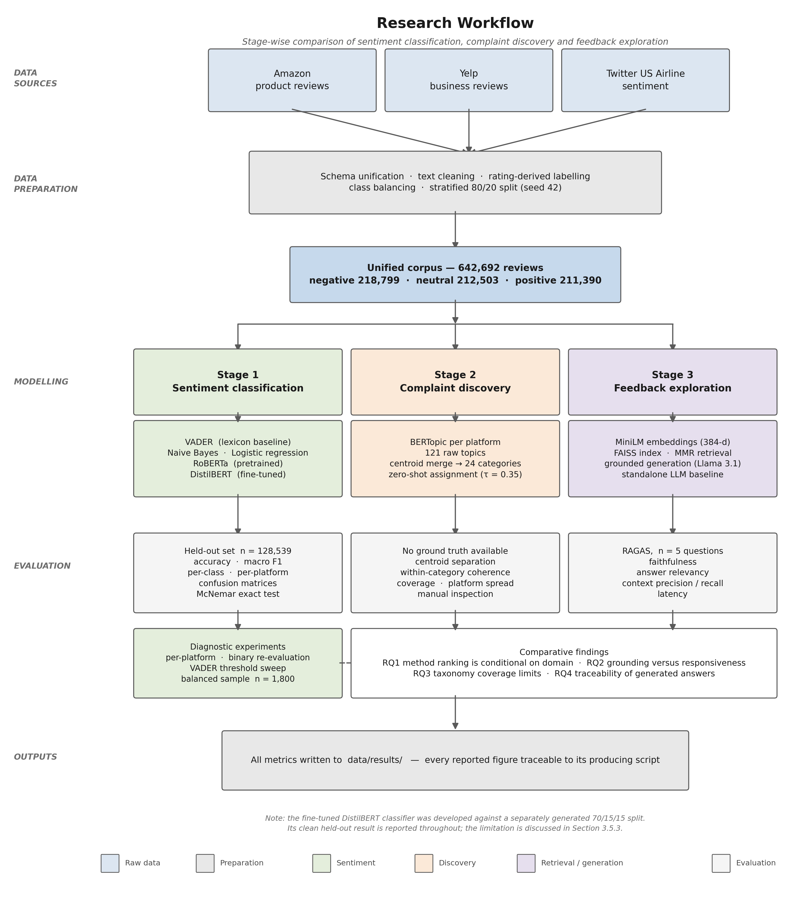
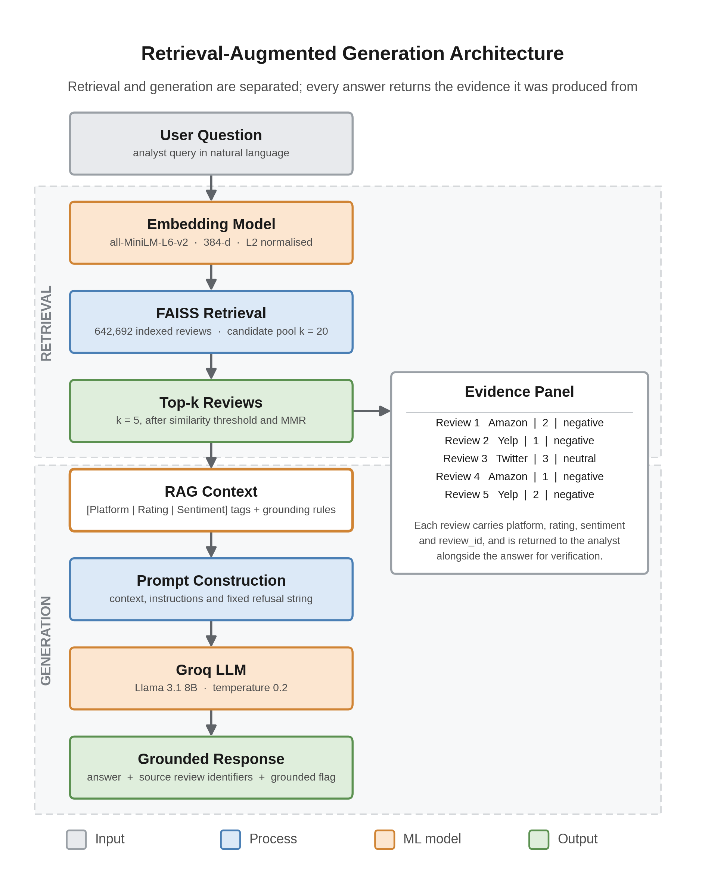
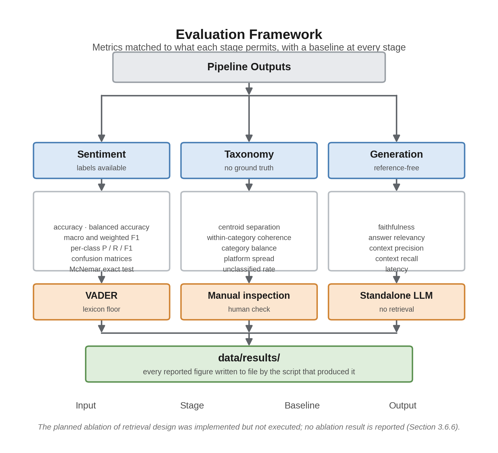

# Chapter 3 — Research Approach

Chapter 2 ended with a gap and four complaints about how the existing literature is evaluated: comparisons run within one domain, aggregate metrics that hide class-level failure, topic models validated by a single contested coherence score, and retrieval-augmented systems adopted without being measured against the baseline they are meant to improve on. This chapter sets out a methodology designed against those four complaints.

Its purpose is twofold: to make the work reproducible, and to justify each decision against the limitation it responds to, so the results in Chapter 4 can be read with the right qualifications already attached. Where a decision was constrained rather than optimal, that is stated at the point the decision is described. Full hyperparameter configurations are given in Appendix B.

---

## 3.1 Research Methodology

**CRISP-DM, adapted for a comparative experimental design**, is used. The choice between available methodologies turns on where a project's contribution sits. Design Science Research suits work whose contribution is the artefact itself; here the pipeline is the instrument and the comparison is the contribution, so organising around artefact construction would misplace the emphasis and invite a write-up that describes a system rather than evaluates a question. KDD stops short of the evaluation depth this study needs. Agile addresses project management rather than analytical validity, which is what is at risk.

CRISP-DM fits for two reasons bearing directly on Chapter 2's criticisms. Its evaluation phase is explicit and iterative, which suits a study whose contribution lies in evaluation rather than modelling. And its data preparation phase is treated as substantial work rather than a preliminary, which matters because preparation is precisely where a comparison becomes controlled or fails to. The adaptation is that modelling and evaluation execute three times, once per pipeline stage, since each stage has its own candidate methods and appropriate metrics — a direct consequence of Chapter 1's argument that feedback analysis is not one task but three. Deployment is out of scope and treated as future work.

**Table 3.1** — Mapping of CRISP-DM phases to objectives and research questions

| Phase | Objective | RQ | Output |
|---|---|---|---|
| Business understanding | O1 | RQ1–RQ4 | Literature review, research gap |
| Data understanding | O2 | — | Exploratory analysis, dataset profile |
| Data preparation | O2 | — | Unified corpus, documented split |
| Modelling (stage 1) | O3 | RQ1 | Five trained or configured classifiers |
| Modelling (stage 2) | O4 | RQ3 | Per-platform topics, merged taxonomy |
| Modelling (stage 3) | O5 | RQ2, RQ4 | RAG pipeline and standalone baseline |
| Evaluation | O6 | RQ1–RQ4 | Metrics, baselines, diagnostics, ablation |
| Conclusion | O7 | RQ1–RQ4 | Critical discussion, limitations, future work |

---

## 3.2 Data

### 3.2.1 Sources and characteristics

Three public datasets are used, chosen so the corpus spans genuinely different registers rather than three variations of one thing — the direct response to Section 2.1.3's dataset criticism, since a study claiming something about domain transfer must contain domains that actually differ.

**Amazon product reviews** cover physical goods, where complaints concern quality, delivery and value, and length varies widely. **Yelp reviews** describe service and hospitality experiences and are the longest in the corpus, typically extended narrative. **Twitter US Airline Sentiment** provides short, abbreviated, public-facing complaints about delays, cancellations and baggage. The three differ on register, length and communicative purpose simultaneously: a reviewer writing for other shoppers, a diner writing a narrative, and a customer publicly demanding a response are doing different things with language.

**Table 3.2** — Composition of the unified corpus

| Platform | Reviews | Share | Label origin | Median words |
|---|---:|---:|---|---:|
| Yelp | 449,858 | 70.0% | Star rating | 85 |
| Amazon | 178,883 | 27.8% | Star rating | 29 |
| Twitter Airline | 13,951 | 2.2% | Human annotation | 19 |
| **Total** | **642,692** | **100%** | | |

Sentiment classes are near-balanced — negative 34.0%, neutral 33.1%, positive 32.9% — which is what makes macro F1 a fair headline metric. Platform representation is heavily skewed, and that asymmetry drives two later decisions: per-platform topic discovery, and platform-balanced diagnostic sampling.

### 3.2.2 Labelling, and the ceiling it imposes

Labels for Amazon and Yelp derive from star ratings: two or below negative, three neutral, four or above positive. This is standard practice at this scale — it is what makes corpora of this size possible — but it is an approximation. A four-star review can contain a specific complaint and will be labelled positive. This places a ceiling on the accuracy any classifier in this study can reach, and it is the most likely source of difficulty on the neutral class, since a three-star review is the least semantically coherent of the three groups.

Label provenance is also not homogeneous. Twitter labels come from human annotation, so "neutral" means a three-star rating on two platforms and a human judgement of no clear sentiment on the third. This is a genuine threat to cross-platform comparability and is reported as such wherever per-platform results are interpreted — and, as Chapter 5 shows, it becomes the explanation for the study's central anomaly.

Two further constraints: Twitter contributes only 2.2% of the corpus, so per-platform analysis on that subset rests on fewer examples and is read with more caution; and review data carries selection bias, since people with strong opinions are more likely to write, so no claim about population-level customer sentiment is made anywhere in this dissertation.

---

## 3.3 Research Process

The workflow runs in five stages, each evaluated before the next depends on it: data preparation producing `reviews_unified.parquet`; sentiment classification of five models on a shared held-out split; complaint discovery per platform with cross-platform merging; retrieval and question answering, with and without retrieval for comparison; and evaluation with baselines and diagnostic experiments.

{width=4.6in}

**Figure 3.1** — End-to-end research workflow. Three raw review sources are unified into a single corpus feeding three independently evaluated stages.

Stage ordering is not arbitrary, and the dependencies propagate. Sentiment classification precedes discovery because discovery operates on negative reviews only, so a review misclassified as negative enters the topic model as noise. Discovery precedes retrieval because the taxonomy provides the vocabulary in which complaints are described. Each stage therefore inherits the limitations of the one before it — itself a finding worth reporting rather than a flaw to conceal.

---

## 3.4 Tools

Python 3 with pandas and scikit-learn for data handling, classical models, splitting and classification metrics. Hugging Face Transformers supplies RoBERTa and DistilBERT with the `Trainer` API, chosen because its model hub makes the exact checkpoints identifiable by name rather than description. `vaderSentiment` provides the lexicon baseline. BERTopic with UMAP and HDBSCAN handles discovery, configured explicitly rather than left at defaults so results are attributable to choices rather than library conventions. `sentence-transformers` supplies `all-MiniLM-L6-v2` (384 dimensions) and FAISS provides the vector index, running locally with no external service — an index depending on a hosted service cannot be reconstructed once that service changes. Generation uses Groq's `llama-3.1-8b-instant` at temperature 0.2, orchestrated with LangChain; low temperature is deliberate, since the task is evidence-grounded answering where output variability is a defect and a reproducible evaluation requires responses that do not swing between runs. RAGAS supplies generation metrics and MLflow tracks experiments, preserving parameters, metrics and artefacts per run.

Every dependency is version-pinned in `requirements.txt`, seeds are fixed at 42 throughout, and unit tests cover the topic-merging and category-shortlisting logic.

`[AUTHOR TO ADD: exact Python version; hardware used for DistilBERT fine-tuning — GPU model and memory, or Colab tier; and the public repository URL if the code is released.]`

---

## 3.5 Data Processing

Each source is mapped onto a common schema. Cleaning removes records with missing text or labels and reviews of five characters or fewer, normalises case and whitespace, and produces `cleaned_text` alongside the original `text`. Both are retained deliberately: models consume the cleaned version while retrieval serves the original, since an analyst reading a retrieved review as evidence needs it readable. The discovery stage additionally filters to English, since mixed languages cluster by language rather than subject, producing topics that describe the corpus's composition instead of its complaints.

### 3.5.1 Data splitting

Splitting is where a comparative study is either controlled or not, so it is stated precisely.

For the sentiment comparison, the corpus is split 80/20 with stratification on sentiment label and `random_state=42`, giving a held-out test set of **128,539 reviews**. Stratification keeps the class distribution identical across partitions, so a model cannot gain on the aggregate simply because one partition contained more of the class it handles best.

The fine-tuned DistilBERT model was trained using a 70/15/15 stratified split, also seeded at 42, with validation used for early stopping and best-checkpoint selection.

**A limitation must be recorded here, and it is the most consequential methodological caveat in this dissertation.** The fine-tuned model and the other four were developed against separately generated corpus versions. The partitions are therefore not identical, and a proportion of the shared test set overlaps data the fine-tuned model saw during training. The comparison is consequently controlled for four of the five models and not for the fifth.

Three things follow. The clean figure for the fine-tuned model is the one obtained on its own held-out partition, and that is the figure interpreted in Chapter 5. Any statement comparing it directly against the others on the shared set is qualified at the point it is made. And establishing a single canonical split, generated once and reused by every model, is Chapter 6's first recommendation. Stating this openly is preferable to presenting a comparison whose controls do not hold; it also means the fine-tuned model's advantage on the shared split should be read as an upper bound rather than a point estimate.

---

## 3.6 Model Development

### 3.6.1 Sentiment classification

Five models span four method families, each representing a distinct answer to the same problem rather than a variation on one answer.

**VADER** requires no training; its compound score maps to three classes at the conventional ±0.05 thresholds. Retaining the convention matters for comparability, and the threshold sweep in Section 3.6.5 tests whether that convention is what limits its performance.

**Naive Bayes** and **logistic regression** operate over TF-IDF features with unigrams and bigrams, logistic regression using lbfgs with `max_iter=3000`, both trained on the 80/20 split with five-fold stratified cross-validation during development. Tuning these properly is a methodological commitment rather than routine: Section 2.1.3 criticised published comparisons for pairing carefully fine-tuned transformers against under-tuned classical baselines, and repeating that asymmetry would reproduce the bias this study set out to test.

**RoBERTa** is used pretrained and unmodified in the `twitter-roberta-base-sentiment-latest` configuration, truncated at 512 tokens, and deliberately not fine-tuned. Its role is to represent what transfer learning achieves *without* task-specific training — the condition a practitioner faces adopting an off-the-shelf model — and since this checkpoint was pretrained on tweets (Barbieri et al., 2020), it makes the domain-transfer question directly testable across three registers.

**DistilBERT** is fine-tuned from `distilbert-base-uncased` with a three-class head; the full configuration is in Appendix B. Two choices deserve justification because both were non-obvious in implementation. Class weighting was applied through a custom trainer overriding the loss function, because the standard `Trainer` ignores class weights passed by configuration; without this the neutral class would be under-served despite a balanced corpus — a defect invisible in aggregate metrics and visible only per class. And early stopping selected on validation macro F1 rather than loss, because macro F1 is what the study reports, and selecting checkpoints on one quantity while reporting another risks presenting a model optimised for something other than the reported result.

### 3.6.2 Complaint discovery and category assignment

BERTopic runs separately on the negative reviews of each platform. This is a deliberate control: Yelp contributes 70% of the corpus, and pooling would let it dominate the topic space, producing a taxonomy that describes restaurant service and calls it customer feedback. The cost is that topics must afterwards be reconciled across platforms — the study accepts a harder consolidation problem in exchange for a taxonomy that is not simply a description of its largest source.

Minimum topic size is derived from corpus size rather than fixed, at approximately 0.15% of each platform's document count, bounded between 30 and 300. This keeps granularity comparable across platforms of very different sizes; a fixed minimum would produce either an unusable proliferation of topics on the largest platform or almost none on the smallest. In practice this gave 86 for Amazon, 224 for Yelp and 30 for Twitter Airline, where the lower bound binds.

Per-platform topics are then merged by taking each topic's centroid embedding and applying agglomerative clustering down to a target of 24 categories. Each merged cluster is named by a language model given the constituent topic labels and keywords, producing a category name, one-sentence description and exemplar phrases. The description is not presentational — it becomes the hypothesis used by the zero-shot classifier at assignment, so the naming step directly determines assignment quality, a dependency whose consequences Chapter 4 reports.

Assignment uses two stages. An embedding comparison ranks all categories and retains a shortlist of six; a zero-shot entailment model then scores only that shortlist, using each category's description as the hypothesis sentence. This follows Schopf et al. (2022), who found similarity-based methods outperforming zero-shot approaches across four datasets — which is the external justification for shortlisting by similarity before applying entailment rather than running entailment over the full taxonomy. The shortlist also keeps entailment cost bounded as the taxonomy grows. A confidence threshold of 0.35 leaves weak matches unclassified rather than forcing a label: a deliberate trade of coverage for honesty, since the unclassified rate becomes a reportable measure of taxonomy coverage instead of a hidden error. As Chapter 4 shows, that decision is what made the taxonomy's principal weakness measurable rather than invisible.

### 3.6.3 Retrieval and generation

The corpus is embedded with `all-MiniLM-L6-v2` and indexed in FAISS with normalised vectors. Retrieval returns five reviews per query from a candidate pool of twenty, selected by maximal marginal relevance. MMR is preferred over plain similarity for a domain-specific reason: complaint questions tend to retrieve near-duplicate reviews expressing the same grievance, and five restatements of one complaint provide weaker grounding than five distinct ones while scoring identically on similarity.

Each retrieved review is tagged with platform, rating and sentiment before entering the prompt. This is not cosmetic — the prompt instructs the model to cite only platforms present in the evidence, and without the tags that instruction can neither be followed nor checked. It is also the one design decision Chapter 4 tests directly rather than argues for (Section 4.5.8). The prompt further requires that no statistic, category or quotation appear unless present in the retrieved text, and specifies a fixed refusal string for insufficient evidence, making refusal an available output rather than something the model must improvise.

**Two guards sit in front of generation, and the difference between them matters.** Section 2.1.2 established that a prompt-level instruction to refuse is a request, not a constraint: Ji et al. (2023) document models producing fluent, confident text with no evidential basis, and an instruction not to is enforced only by the model's compliance. Two architectural gates therefore precede the prompt.

The first is a **scope guard** rejecting questions not about customer feedback at all. It runs in two stages — a keyword filter naming nine off-topic subjects, then a small LLM classifier for cases the keyword list cannot catch — and returns a fixed out-of-scope message without touching the retriever. The design assumption is that a wrongly rejected question is a cheaper failure than a confidently answered off-topic one. Chapter 4 finds a case testing that assumption.

The second is a **similarity threshold** on retrieval, set at 0.35. FAISS returns its top *k* regardless of how weakly documents match, so without a floor the pipeline hands the model five nearest-but-possibly-irrelevant reviews and relies on the prompt to talk it out of using them. The threshold makes "no relevant evidence exists" a fact the code checks rather than a judgement the model makes each time: candidates below it are discarded, and if nothing survives a fixed no-evidence message replaces generation. A post-generation check repeats the test for multi-turn queries, where the retrieval query is an LLM-reformulated question the pre-check never saw. The value 0.35 was chosen by inspecting this index's score distribution and has not been tuned against a labelled set of in-scope and out-of-scope questions, which Chapter 6 identifies as outstanding work.

{width=4.6in}

**Figure 3.2** — Retrieval-augmented architecture. The scope guard runs before retrieval is attempted; the similarity threshold gates retrieval output before generation.

The same questions are then answered with no retrieval, providing the RQ2 baseline. Holding generator, temperature and question set constant means the difference is attributable to retrieval rather than model or prompt variation.

### 3.6.4 Evaluation metrics

Metrics are matched to what each stage permits.

{width=4.6in}

**Figure 3.3** — Evaluation framework across the three stages.

**Sentiment.** Accuracy, macro F1, weighted F1, per-class precision, recall and F1, and confusion matrices. Macro F1 is the headline because it weights all classes equally and exposes the single-class collapse Section 2.1.3 identified as the literature's blind spot. Per-platform metrics are reported alongside aggregates for the same reason. Pairwise comparison uses McNemar's exact test, appropriate for paired predictions on a common test set.

**Taxonomy.** No ground truth exists, so no accuracy is computed and none implied. Quality is argued from mean pairwise similarity between merged centroids, within-category coherence, category frequency distribution, platform distribution, and unclassified rate, with a sample set aside for manual inspection. Reporting five weak indicators together is the direct methodological response to the coherence-validity critique in Section 2.1.3: if no single automated measure is trustworthy, a claim should not rest on one.

**Generation.** RAGAS faithfulness, answer relevancy, context precision and context recall, for both conditions. Four metrics are used because they disagree informatively — an unconstrained model can score highly on relevancy while having no evidential basis, so relevancy alone would reward precisely the behaviour the system exists to prevent.

**Diagnostic experiments.** Aggregate metrics establish a ranking but not a cause, and Chapter 2 criticised the literature for stopping at the ranking. Three experiments test proposed explanations rather than leaving them as speculation: a per-platform breakdown on a sample balanced across platform and class (600 per platform, 1,800 total); a binary re-evaluation removing the neutral class and requiring each model to choose between negative and positive from its own class scores; and a threshold sweep re-labelling VADER's cached compound scores across progressively wider neutral bands. All three reuse one cached set of predictions, so each model runs over the sample once — a practical necessity given transformer inference cost, and one that guarantees the three diagnostics describe identical model behaviour. They are computed on the 1,800-review sample rather than the full test set, so their figures are not interchangeable with the headline metrics and are not treated as such.

A constraint on the generation evaluation belongs here rather than in the results: the model judging answers is the model producing them, introducing the self-enhancement bias documented in Section 2.2.3. This followed from free-tier API limits, which also constrained the number of evaluation questions. Both bound the RQ2 and RQ4 conclusions and are restated wherever those conclusions appear.

### 3.6.5 Ablation design, and what was carried out

Section 2.2.3 argued that reporting a system-level faithfulness score does not attribute grounding to any particular design decision, and that ablation is the standard remedy. Four conditions were designed, each isolating one decision while holding everything else constant: **metadata tagging** (tags present or absent in the prompt context), **retrieval depth** (*k* ∈ {3, 5, 10, 20}), **retriever type** (MMR against plain similarity) and **prompt version** (constrained grounding prompt against a plain instruction).

**One was built and run; three were specified but never built.** The **metadata-tagging condition** was executed in `evaluate/ablation_metadata_tagging.py`, running the same five questions twice through the same pipeline with retrieval held identical, so any difference in RAGAS scores is attributable to what the generator was shown rather than what was retrieved. Section 4.5.8 reports the result, which does not straightforwardly confirm the argument made above.

The remaining three exist as the specification and nothing more. Each requires a full pass over the question set with several judged sub-calls per answer, and the free-tier rate limit made that volume unreachable within the timeframe; rather than write code that could not be run, the effort went into completing one condition properly. The consequence is stated plainly: for retrieval depth, retriever type and prompt version, the contribution of each decision is argued from design reasoning, not measured.

Two scripts therefore carry the generation evaluation, both in the submitted codebase: `evaluate/evaluate_llm_vs_rag.py` and `evaluate/ablation_metadata_tagging.py`. The same rate limit constrained both to **five questions**, small enough that per-question variance dominates the reported means, so Chapter 5's answer to RQ2 is framed as directional.

---

## 3.7 Ethical Considerations

All three datasets are publicly available and were collected and released by their original publishers. No data was scraped and none gathered from individuals, so no human participants were involved and no ethical approval for participant research was required.

The reviews contain no special-category personal data. Reviewer names are not used, and reviews are referenced by identifier only. Two residual risks are recorded. Review text occasionally contains personal detail written by the reviewer, so no attempt is made to link reviews to individuals or to reconstruct identity from content. And generated summaries describe named businesses, where acting on an unsupported summary could affect one unfairly — returning source reviews with every answer is a partial safeguard, since a claim can be checked before it is used.

---

## 3.8 Chapter Summary

This chapter set out a methodology built against four criticisms of the existing literature: a corpus spanning three genuinely different registers rather than one domain; per-class and per-platform reporting alongside aggregates; five indicators for the taxonomy rather than one contested coherence score; and a standalone baseline against which the retrieval-augmented system is measured rather than assumed superior. Where the design falls short of its own standard — the split limitation in Section 3.5.1, and the three ablation conditions never built — that is stated at the point it arises rather than deferred.

Chapter 4 reports what this methodology produced.
