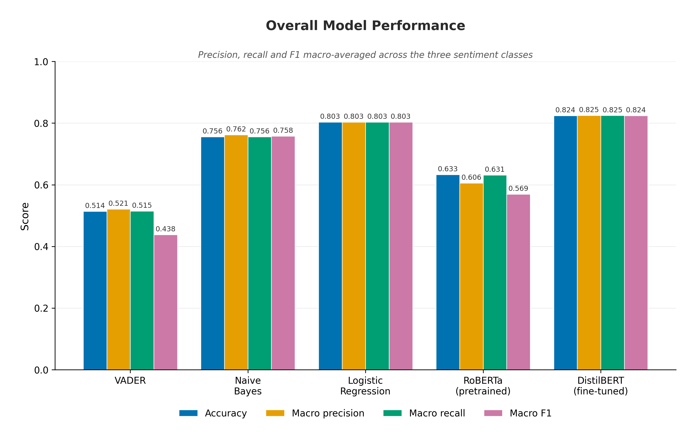
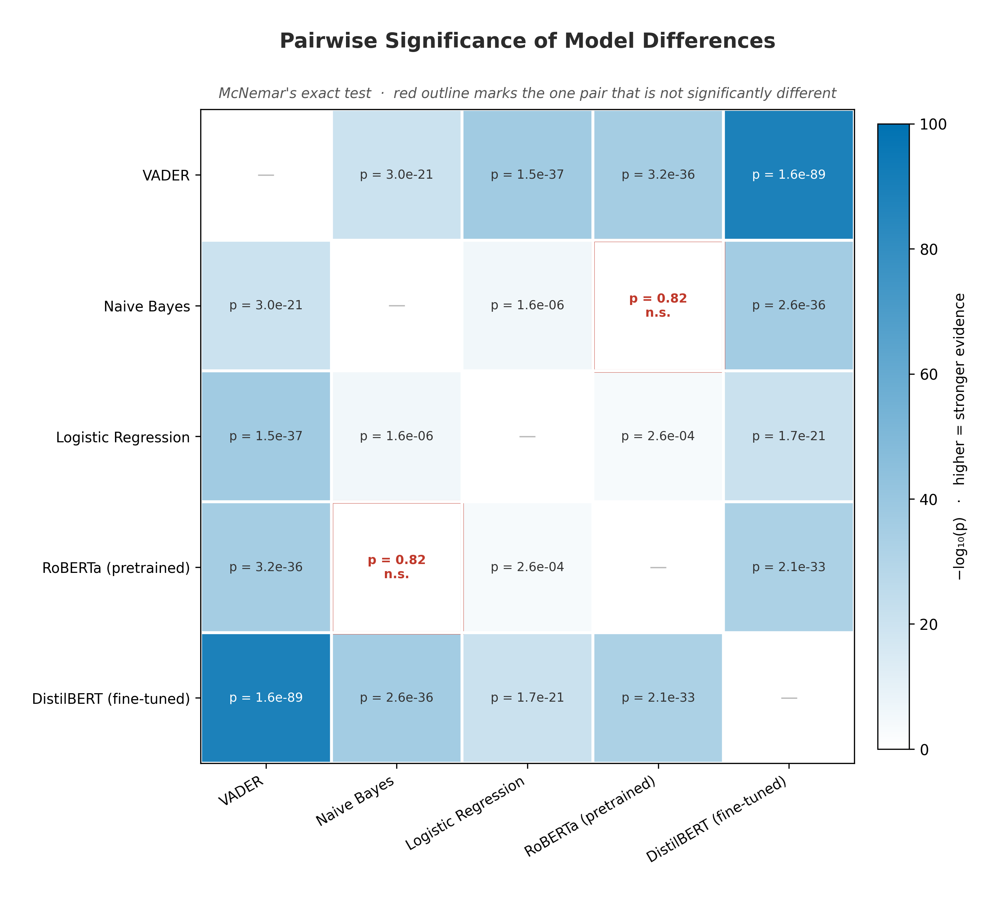

**Table 4.3** — — DistilBERT validation performance by epoch

| Epoch | Training loss | Validation loss | Accuracy | Weighted F1 | Macro F1 |
|---:|---:|---:|---:|---:|---:|
| 1 | 0.2612 | 0.4482 | 83.48% | 83.51% | 82.59% |
| 2 | 0.2810 | 0.3977 | **84.08%** | **84.13%** | **83.28%** |
| 3 | 0.2355 | 0.4508 | 83.98% | 84.00% | 83.12% |
| 4 | 0.2007 | 0.5225 | 83.73% | 83.71% | 82.80% |

**Table 4.6** — — Per-class precision, recall and F1 by model, shared test set (n = 128,539) *(source: `data/results/metrics_summary/per_class_metrics.csv`)*

| Model | Neg. P | Neg. R | Neg. F1 | Neu. P | Neu. R | Neu. F1 | Pos. P | Pos. R | Pos. F1 |
|---|---:|---:|---:|---:|---:|---:|---:|---:|---:|
| VADER | 0.743 | 0.533 | 0.621 | 0.377 | **0.048** | **0.086** | 0.444 | 0.963 | 0.608 |
| Naive Bayes | 0.757 | 0.766 | 0.761 | 0.654 | 0.704 | 0.678 | 0.876 | 0.798 | 0.835 |
| Logistic Regression | 0.818 | 0.830 | 0.824 | 0.721 | 0.715 | 0.718 | 0.871 | 0.864 | 0.868 |
| RoBERTa (pretrained) | 0.684 | 0.814 | 0.743 | 0.522 | **0.143** | **0.225** | 0.612 | 0.937 | 0.740 |
| DistilBERT (fine-tuned) | 0.856 | 0.820 | 0.837 | 0.740 | 0.755 | 0.747 | 0.879 | 0.899 | 0.889 |

**Table 4.8** — — McNemar pairwise comparisons, balanced diagnostic sample (n = 1,800) *(source: `data/results/metrics_summary/significance_tests.csv`)*

| Model A | Model B | A acc. | B acc. | Discordant pairs | p-value | Significant | Better |
|---|---|---:|---:|---:|---:|---|---|
| VADER | DistilBERT | 0.5539 | 0.8417 | 734 | 1.6 × 10⁻⁸⁹ | yes | DistilBERT |
| VADER | Logistic Regression | 0.5539 | 0.7444 | 741 | 1.5 × 10⁻³⁷ | yes | Logistic Regression |
| Naive Bayes | DistilBERT | 0.6983 | 0.8417 | 444 | 2.6 × 10⁻³⁶ | yes | DistilBERT |
| VADER | RoBERTa | 0.5539 | 0.6944 | 429 | 3.2 × 10⁻³⁶ | yes | RoBERTa |
| RoBERTa | DistilBERT | 0.6944 | 0.8417 | 505 | 2.1 × 10⁻³³ | yes | DistilBERT |
| Logistic Regression | DistilBERT | 0.7444 | 0.8417 | 349 | 1.7 × 10⁻²¹ | yes | DistilBERT |
| VADER | Naive Bayes | 0.5539 | 0.6983 | 764 | 3.0 × 10⁻²¹ | yes | Naive Bayes |
| Naive Bayes | Logistic Regression | 0.6983 | 0.7444 | 295 | 1.6 × 10⁻⁶ | yes | Logistic Regression |
| Logistic Regression | RoBERTa | 0.7444 | 0.6944 | 596 | 2.6 × 10⁻⁴ | yes | Logistic Regression |
| **Naive Bayes** | **RoBERTa** | **0.6983** | **0.6944** | **675** | **0.82** | **no** | **—** |

**Table 4.13** — — Within-category coherence against category size, selected categories *(source: `data/results/category_discovery/category_coherence.csv`)*

| Category | Reviews | Mean coherence |
|---|---:|---:|
| Travel Disruption Issues | 11 | 0.6763 |
| Home Network Connectivity Issues | 7 | 0.6410 |
| Service and Wait Time Delays | 35 | 0.5678 |
| Audio Performance Failures | 22 | 0.5546 |
| Product Fit and Sizing Issues | 25 | 0.4079 |
| Product Performance Failures | 127 | 0.3997 |
| Unclassified / Emerging Complaint | 124 | 0.3767 |

**Figure 4.8**

{width=4.6in}

**Figure 4.8** — VADER macro F1, neutral F1 and accuracy across neutral-band widths. Macro F1 peaks at ±0.25 and declines thereafter. *(Produced by `evaluate/evaluate_sentiment_diagnostics.py`.)*

**Figure 4.10**

{width=4.6in}

**Figure 4.10** — Distribution of categories across the three platforms.

**Figure 4.12**

{width=4.6in}

**Figure 4.12** — Mean within-category coherence against category size. The two largest categories record the lowest coherence of any category holding more than three reviews. *(All four produced by `evaluate/evaluate_category_discovery.py`.)*

{width=4.6in}

**Figure 4.2** — Sentiment classification performance for all five models on the shared held-out set (n = 128,539): accuracy with macro-averaged precision, recall and F1. *(Produced by `evaluate/generate_all_metrics.py`.)*

{width=4.6in}

**Figure 4.4** — Pairwise model comparison under McNemar's exact test, balanced diagnostic sample (n = 1,800). Nine of ten comparisons are significant at p < 0.05. *(Produced by `evaluate/generate_all_metrics.py`.)*

{width=4.6in}

**Figure 4.7** — Mean retrieval latency, dense semantic search against TF-IDF, 30 queries over 642,692 indexed reviews. Precision@3 is identical between methods at 0.90 and is therefore reported in Table 4.7 rather than charted. *(Produced by `scripts/compare_embedding.py`.)*

{width=4.6in}

**Figure 4.8** — Answer relevancy, retrieval-augmented pipeline against standalone LLM (n = 5, n = 4 scored for RAG). The baseline's higher mean rests on four strong scores and one complete failure. *(Produced by `evaluate/evaluate_llm_vs_rag.py`.)*

### Qualitative error-analysis examples (Chapter 4, Section 4.5.4)

**Qualitative error analysis.** The three experiments establish *where* errors concentrate but not what they look like, so individual misclassified reviews were inspected by joining the cached per-review predictions back to the source text (`evaluate/extract_error_examples.py`). Three patterns account for most failures, each corresponding to one of the quantitative findings above. Text is verbatim, truncated where long.

*Pattern 1 — mixed evaluative content in three-star reviews.* Of the 600 true-neutral reviews in the balanced sample, 300 were assigned a polar label by RoBERTa while the fine-tuned model assigned neutral correctly. Inspection shows these are not ambiguous in the sense of being uninformative; they are reviews containing clear praise and clear criticism in the same text:

> *"Nice curl finish. This product was hard to install could not put thick sections in small sections only curls came out pretty though"* — Amazon, 3 stars. RoBERTa: negative. VADER: positive.

> *"Fenugreek Tea. The tea is very good however the bags are fragile and quite a few had already spilled its contents in the box"* — Amazon, 3 stars. RoBERTa: positive. VADER: positive.

> *"Not a fan of the chewy tapioca balls. Heard good things and I'm very sure this kit is good if you go into it knowing what to expect but not a great experiment for a newbie."* — Amazon, 3 stars. RoBERTa: negative. VADER: positive.

Each contains an explicit positive clause and an explicit negative clause. A three-star rating encodes the reader's net judgement across both; a model trained to detect the *absence* of clear sentiment has no representation for a text that expresses two strong sentiments simultaneously. This is the concrete form of the label-mismatch account developed in Section 5.1.1.

*Pattern 2 — positive vocabulary in negative reviews.* VADER assigned a positive label to 201 of the 600 true-negative reviews in the sample. The compound scores show why:

> *"Very bland. Ok, first off let me just say that I am a very clean eater and I HATE the sodium bloat…"* — Amazon, 2 stars. VADER compound = **+0.890**.

> *"only lasted 3 months. Worked well and looked good until keys stopped working after 3 months. My previous keyboard lasted 3 years"* — Amazon, 1 star. VADER compound = **+0.477**.

> *"Not a fan. I love nut pods but don't care for this flavor."* — Amazon, 1 star. VADER compound = **+0.752**.

In each case the lexicon's positive terms ("clean", "love", "worked well", "looked good") outweigh the negative ones, because scoring is applied to words rather than to the clauses those words sit in. The second example is the clearest: the complaint is carried entirely by the temporal contrast between "worked well" and "until keys stopped working", which a bag-of-words score cannot represent. This is the mechanism behind the 40.4% negative-to-positive rate in Table 4.7, and it explains why the threshold sweep recovers so little — the errors are not near the decision boundary but confidently on the wrong side of it.

*Pattern 3 — reviews all five models misclassify.* In 74 of the 1,800 cases (4.1%) every model was wrong. These are qualitatively different from the two patterns above:

> *"Photos Off Color to What I Was Expecting. I love everything about this except the color depiction and description…"* — Amazon, 2 stars, labelled negative. All five models predicted positive or neutral.

> *"Very unhealthy but tasted pretty good. Once preservatives and palm oil are removed we would consider b…"* — Amazon, 2 stars, labelled negative. Four models predicted neutral, one positive.

Here the disagreement is arguably with the label rather than with the models. A reviewer who writes "I love everything about this except…" and awards two stars is expressing a judgement that the text alone does not convey, and no classifier reading only the text can recover it. This category is small but it is the empirical face of the labelling ceiling described in Section 4.2.4: some portion of the residual error in every model is imposed by rating-derived labels rather than by modelling capacity, and 4.1% is a lower bound on that portion for this sample.

{width=4.6in}

**Figure 4.2** — Row-normalised confusion matrices for all five models (n = 128,539). VADER and RoBERTa push the majority of genuinely neutral reviews into the polar classes. *(Produced by `evaluate/generate_figures.py`; the filename retains an earlier numbering.)*
